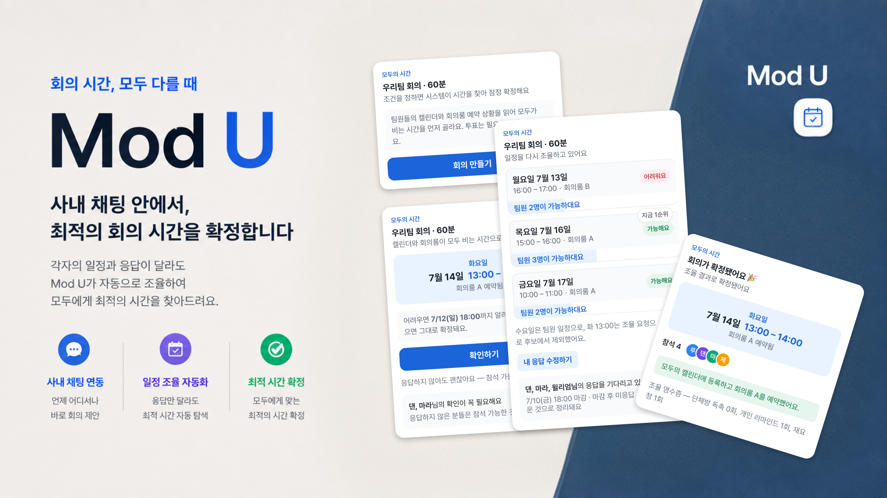

# Mod U — 모두의 시간


**modu** = 모두(everyone), 그리고 **Mod U** — 회의를 잡는 방식을 개조하다.
침묵은 동의다(tacit consent). 각자의 일정과 응답이 달라도 시스템이 조율해 회의가 확정되는, 팀 채팅방 안의 일정 조율 경험을 다룹니다.

토스 2026 프로덕트 디자이너 챌린지 주제를 기반으로 만든 **학습용 인터랙티브 프로토타입**입니다. 사용자 시점과 응답을 바꾸며 서비스 흐름을 확인하고, 디자인 시스템의 공통 UI를 실제 화면에서 재사용하는 구조를 살펴볼 수 있습니다.

[서비스 데모](https://runauxlabs.github.io/modu/) · [Storybook](https://runauxlabs.github.io/modu/storybook/) · [Figma](https://www.figma.com/design/ADGZA9in8smWNHWctdr4ao/%EB%AA%A8%EB%91%90%EC%9D%98-%EC%8B%9C%EA%B0%84--Mod-U-?node-id=0-1&t=CZLdYDLyUwqfK2up-1)

## 이 저장소에서 살펴볼 수 있는 것

- **서비스 흐름**: 회의 생성 → 잠정 확정 → 이의에 따른 조율 → 확정 또는 가능한 시간 없음.
- **상태에 따른 UI**: 주최자·필참자·선택 참석자의 화면 차이와 응답·마감 처리에 따른 변화.
- **디자인 시스템 재사용**: 공통 토큰과 컴포넌트를 화면마다 복제하지 않고 불러와 조립하는 방식.
- **Storybook과 서비스의 연결**: 컴포넌트 단독 모습, 조합 모습, 실제 서비스 시나리오를 같은 구현으로 확인하는 방식.

### 동작 범위

화면 조작과 상태 전환은 브라우저에서 동작합니다. 캘린더 조회·등록, 회의룸 예약, 채팅 분석, 외부 알림 전송은 준비된 데이터와 화면 문구로 재현하며 실제 서비스에 연동하지 않습니다. 계정 전환도 로그인 대신 제공하는 시점 전환 기능입니다. 상태는 메모리에 유지되고 새로고침하면 초기화됩니다.

시나리오의 ‘오늘’은 **2026년 7월 9일**로 고정되어 있습니다. 실제 날짜와 관계없이 같은 흐름을 확인하기 위한 구성입니다.

## 테스터 사용법

- **시점 전환**: 좌측 컨트롤에서 팀원 6명의 아바타를 탭하면 그 사람 시점의 메신저 화면으로 전환됩니다. 상태는 전 계정이 공유합니다.
- **시작은 생성부터**: 첫 진입은 회의 생성 전입니다. 루나 시점에서 [회의 만들기]로 필참자를 직접 지정해보세요(전원 필참으로 바꾸면 무응답 처리가 어떻게 달라지는지도 볼 수 있습니다). 생성하지 않고 시간을 진행하면 기본 조건으로 자동 생성됩니다.
- **시간 진행**: T0(생성·잠정 확정) → T1(조율 모드) → T2(마감 임박) → T3(마감 이후). 직접 응답하지 않은 팀원만 각자의 기본 행동대로 움직입니다.
- **초기값에는 출처가 있습니다**: 생성 시트의 제목·길이·기간·마감에는 채팅과 캘린더에서 추론한 것으로 설정된 샘플 값과 근거 문구가 있습니다. 값을 누르면 수정할 수 있습니다.
- **다른 결과 탐색**: 필참자를 모든 후보 시간에 '어려움'으로 응답하게 하면 가능한 시간이 없는 상태가 됩니다. 기간을 넓혀 다시 조율하거나, 리셋 후 필참 구성과 응답을 바꿔 비교합니다. 확정 화면 마지막 줄의 **조율 영수증**("단체방 독촉 0회…")도 확인해보세요.

## 설계 요약

- **계층 1 — 잠정 확정**: 캘린더∩회의룸 최적 슬롯으로 시스템이 잠정 확정. 침묵 = 동의.
  필참자만 확인 탭 1회. 이의는 주최자에게만 비공개 전달.
- **계층 2 — 조율 모드 (폴백)**: 이의 발생 또는 교집합 부재 시에만. 후보 3개 탭 응답,
  이름 현황판, 마감 후 역할별 무응답 처리 (선택→불참 정리, 필참→에스컬레이션).
- **침묵의 비용 귀속**: 필참자의 침묵은 집단의 비용 → 시스템이 쫓아간다. 선택 참석자의 침묵은
  본인의 비용 → 시스템이 존중한다. 입력이 결과에 영향을 주는 순간에만 응답을 요청한다.
- **집행 명의의 원칙**: 독촉·불참 정리·확정 통보의 주어는 언제나 시스템/규칙 — 사람이 아니다.
  버블도 주최자의 말풍선이 아닌 시스템 명의의 중앙 카드로 게시된다. 조율의 악역을 사람에게 남기지 않기 위함이다.
- 조율은 기본이 아니라 예외. 응답 비용의 이상값은 0.

## 구조 — 서비스 내부 모듈

```
DESIGN-SYSTEM.md              토큰 스펙 (플러그인 판독용)
docs/design-system/           디자인 가이드라인
.storybook/                   Storybook 설정
stories/                      컴포넌트, 조합, 실제 서비스 시나리오
src/
  design-system/
    index.ts                  공통 컴포넌트 공개 진입점 (@design-system)
    tokens/tokens.css         토큰 값의 정본
    styles.css                공통 UI 스타일
    components/atoms/         기본 UI
    components/molecules/     SlotCard, BubbleShell, MatrixTable 등 조합 UI
  features/
    scheduling/model/         회의 데이터와 상태 머신
    scheduling/components/    상태와 액션을 연결하는 버블·시트
    simulation/               계정·시간 전환 데모 컨트롤
  pages/                      전체 화면과 채팅방 배치
  components/                 기존 import 경로 호환용 재노출 파일
  styles.css                  서비스 화면·기능 레이아웃
```

**디자인 시스템은 이 서비스 전용 내부 모듈인 `src/design-system`에 구현되어 있습니다.** 서비스와 Storybook은 `@design-system`에서 같은 컴포넌트 소스를 직접 불러 씁니다. [토큰 스펙](./DESIGN-SYSTEM.md)은 기계 판독용이고, [가이드라인](./docs/design-system/README.md)은 사람이 읽는 해설입니다. 값의 정본은 `src/design-system/tokens/tokens.css`입니다. 기능과 UI의 경계는 [내부 모듈 안내](./docs/internal-module.md)를 참고합니다.

| 영역 | 책임 | 예시 |
| --- | --- | --- |
| Foundations | 공통 색상·타입·간격·라디우스·그림자·모션 값 | `tokens/tokens.css` |
| 기본 UI | 일관된 형태와 기본 동작 | `Button`, `Avatar`, `Chip`, `Notice`, `Field` |
| 조합 UI | 공통 컴포넌트를 조합한 재사용 단위 | `SlotCard`, `BubbleShell`, `MatrixTable`, `MessageRow` |
| Features | 데이터와 선택값을 UI에 연결하고 행동·상태 전환을 관리 | 회의 생성, 응답 시트, 일정 조율 버블 |
| Pages | 기능과 UI를 전체 화면으로 배치 | `MeetingPage`, `ChatRoom` |

**Figma 디자인 시스템**의 인스턴스 오버라이드는 React props, 슬롯은 children, 기능 연결은 callback으로 대응한다. 컴포넌트별 정의와 설계 의도는 [가이드라인](./docs/design-system/README.md)을 참고한다.

공통 UI의 구현과 스타일을 수정하면 이를 사용하는 서비스와 Storybook 양쪽에 반영됩니다. Storybook은 서비스와 별개로 만든 UI 모음이 아니라 **같은 소스를 여러 상태로 확인하는 도구**입니다. 별도 패키징과 tarball 재설치는 필요 없습니다. 원본 형제 폴더와 `vendor`의 기존 tarball은 실행 의존성에서 제외했습니다.

### 인스턴스 호출 예시

`SlotCard`는 잠정 확정 버블(`hero`), 조율 버블(`tally`), 응답 시트(`respond`)에서 같은 구현을 사용합니다. 응답 시트에서는 선택값과 변경 동작을 전달합니다.

```jsx
import { SlotCard } from '@design-system';

<SlotCard
  slot={slot}
  variant="respond"
  myValue={values[slot.id]}
  onChange={(value) => setValues((previous) => ({
    ...previous,
    [slot.id]: value,
  }))}
/>
```

위 코드는 호출 방식을 보여주는 예시입니다. 카드의 상세 마크업과 공통 스타일은 디자인 시스템에 있고, 현재 선택값과 저장·확정 규칙은 서비스 feature가 관리합니다.

### 현재 재사용 범위와 남은 정리

주요 공통 UI는 컴포넌트로 분리했고, 서비스 화면은 이를 불러와 조합합니다. 기존 `src/components`, `src/store.jsx`, `src/data.js`는 이전 import 경로를 유지하는 재노출 파일이며 상세 구현을 복제하지 않습니다.

모든 화면 요소의 컴포넌트화와 중복 제거가 완료된 것은 아닙니다. 시트의 본문·푸터, 참석자 선택·잠정 확정 현황 행, 푸시 배너·고정 바 등은 서비스 영역에 직접 작성되어 있습니다. 화면 고유의 조립과 추가로 공통화할 수 있는 반복 구조가 함께 남아 있습니다.

공통 토큰의 값은 `src/design-system/tokens/tokens.css`에서 관리합니다. 다만 컴포넌트와 서비스 CSS에 일부 크기·간격·색상 등의 직접 지정값도 남아 있어 모든 디자인 값이 토큰에 연결된 상태는 아닙니다. 이 경계와 남은 정리 범위도 학습 대상으로 다룹니다.

## Storybook 확인 방법

| 영역 | 확인할 내용 |
| --- | --- |
| Foundations | 토큰 값과 적용 모습 |
| Atoms / Molecules | 서비스에서 사용하는 기본·조합 컴포넌트의 형태와 상태 |
| Patterns | 컴포넌트 조합 미리보기와 응답 선택에 따른 카드·현황표 변화 |
| Service Screens | 실제 서비스 코드의 사용자별 화면과 편집·응답·확정 흐름 |

`Service Screens / Workbench`에서는 계정 전환·시간 진행·리셋으로 흐름을 탐색할 수 있습니다. Controls는 예제의 입력값과 시작 상태를 바꾸고, 서비스 화면 안에서의 조작은 실제 상태 머신으로 처리합니다. 미사용 버튼 형태나 구현용 Provider 설명을 별도 영역으로 전시하지 않습니다.

## 실행

요구 사항: Node 22.13.0 이상, pnpm 12.11.2. CI도 `package.json`의 `packageManager` 버전을 사용한다.

`packageManager` 설정은 기존 pnpm 실행 파일을 업데이트하지 않는다. Windows에서 먼저 아래 명령으로 pnpm을 준비한다. 기존 `AppData/Local/pnpm` 경로가 먼저 선택되는 경우를 위해 현재 PowerShell 세션에서는 npm 전역 실행 경로를 우선한다.

```powershell
npm install --global pnpm@12.11.2
$env:Path = "$env:APPDATA\npm;$env:Path"
pnpm --version # 12.11.2 확인
```

위 PATH 변경은 현재 세션에만 적용된다. 새 터미널에서 버전이 되돌아가면 사용자 PATH에서 npm 전역 실행 경로를 기존 pnpm 경로보다 앞에 배치한다. [pnpm 설치 안내](https://pnpm.io/installation)

```bash
pnpm install --frozen-lockfile # 커밋된 lockfile 기준 설치
pnpm dev      # 개발 서버
pnpm storybook # Storybook: http://localhost:6006/
pnpm build    # 프로덕션 빌드 (dist/)
```

서비스와 Storybook을 동시에 확인하려면 각각 다른 터미널에서 실행합니다. 서비스 URL은 터미널에 표시되며, 종료는 `Ctrl+C`입니다.

의존성을 변경할 때는 `pnpm install --no-frozen-lockfile`로 lockfile을 갱신하고 함께 커밋한다. CI는 `pnpm install --frozen-lockfile`로 같은 버전을 설치한다.

pnpm 12의 설치 스크립트 승인 설정은 `pnpm-workspace.yaml`에서 관리한다. Vite가 사용하는 esbuild만 `allowBuilds.esbuild: true`로 허용한다. 설치가 `ERR_PNPM_IGNORED_BUILDS`로 중단된 상태라면 `pnpm rebuild esbuild` 후 `pnpm build`를 실행한다. `pnpm-workspace.yaml`도 소스와 함께 관리한다.

## 검증과 빌드

```bash
pnpm test                   # 공통 컴포넌트 동작 테스트
pnpm test:service-stories    # 실제 서비스 시나리오 테스트
pnpm typecheck:storybook    # 컴포넌트·스토리 타입 검사
pnpm build                  # 서비스 빌드: dist/
pnpm build:storybook        # Storybook 빌드: storybook-static/
pnpm build:pages            # 서비스 + Storybook 배포 결과: dist/
pnpm check                  # 테스트·타입 검사·두 사이트 빌드·배포 폴더 조립
```

테스트와 빌드는 컴포넌트 동작·서비스 시나리오·빌드 가능 여부를 확인합니다. 전체 사용 흐름이나 접근성 기준을 모두 검증했다는 의미는 아닙니다.

## 배포 (GitHub Pages)

1. 변경 사항을 GitHub 저장소에 push (main 브랜치)
2. 저장소 Settings → Pages → Source를 **GitHub Actions**로 설정
3. `.github/workflows/deploy.yml`이 서비스와 Storybook을 함께 빌드·배포 (수동 실행도 가능)

배포 경로는 서비스가 `/modu/`, Storybook이 `/modu/storybook/`입니다. 로컬 수정은 배포 워크플로가 실행되기 전까지 공개 사이트에 반영되지 않습니다.

## 디자인 시스템 노트

- **토큰 중심 관리**: 공통 색·타입·간격·라디우스·모션을 토큰으로 관리합니다. 직접 지정값의 추가 정리는 남아 있습니다.
- **4px 간격 체계**: 기본 간격 토큰은 4px 단위입니다. 타입 크기, 선 두께, 기기 프레임 등에는 별도 값이 있습니다. 현재 데모 폰 프레임은 402×874px이며 좁은 화면에서의 제품 수준 반응형 구현은 별도 과제입니다.
- **타이포**: 12·14·16·18·24px 위계를 사용합니다. 폰트 우선순위는 Pretendard Variable이며, 로딩 환경에 따라 시스템 폰트로 표시될 수 있습니다.
- **접근성 고려**: 일부 텍스트·배경 대비 근거를 토큰 주석에 기록하고 경고 배경용 색과 텍스트용 색을 분리했습니다. 키보드 포커스 표시와 응답 선택의 키보드 조작을 제공합니다. 전체 화면의 접근성 충족 여부는 별도 검토가 필요합니다.
- **인코딩 분리**: 조율 카드에서 색 칩은 '내 상태', 하단 게이지 길이는 '팀의 쏠림'. 집단 추세가 개인 선택으로 오독되지 않도록 시각 채널을 나눔.
